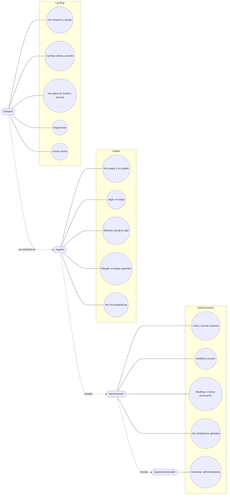
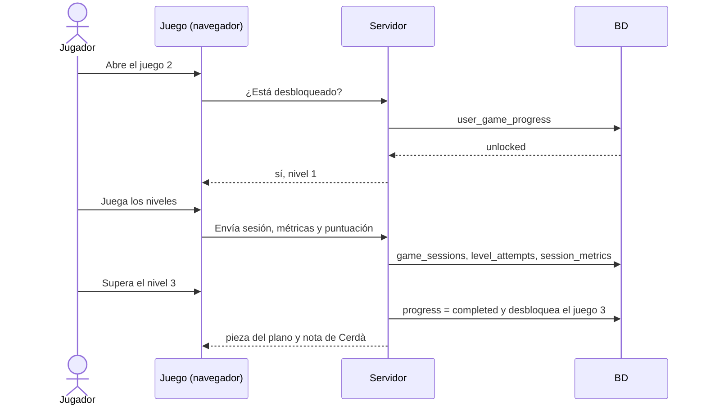

# Casos de uso (borrador)

Borrador para validar con el equipo. Actores: **Visitante** (sin sesión), **Jugador** (registrado), **Administrador** y **Superadministrador**. El administrador hereda lo que hace un jugador y el superadministrador lo que hace un administrador.

## Diagrama general

## Casos de uso principales
| ID | Caso de uso | Actor | Resumen | Resultado |
|---|---|---|---|---|
| CU1 | Registrarse | Visitante | Crea cuenta con usuario, correo y contraseña | Usuario nuevo con el juego 1 abierto y los demás bloqueados |
| CU2 | Iniciar sesión | Visitante | Entra con usuario y contraseña | Sesión iniciada; en la landing ve su progreso |
| CU3 | Ver juegos | Jugador | Ve los 4 juegos; los no desbloqueados salen bloqueados | Estado de cada juego |
| CU4 | Jugar | Jugador | Elige un juego abierto y juega por niveles | Se crea una `game_session` con sus métricas y puntuación |
| CU5 | Superar un juego | Jugador | Completa los 3 niveles | Se guarda el progreso, se desbloquea el siguiente juego y se rellena la pieza del plano |
| CU6 | Retomar o rejugar | Jugador | Vuelve en otra visita y sigue por donde iba, o rejuega uno superado | Progreso recuperado; nueva sesión para el récord |
| CU7 | Ver estadísticas y récords | Visitante / Jugador | Récords diarios y semanales por juego, y los suyos | Tabla de récords |
| CU8 | Gestionar usuarios | Administrador | Lista, busca y modifica usuarios | Cambios guardados y apuntados en `audit_log` |
| CU9 | Gestionar puntuaciones | Administrador | Modifica o elimina una puntuación | Puntuación corregida y apuntada en `audit_log` |
| CU10 | Gestionar administradores | Superadministrador | Crea, modifica o desactiva administradores | Administradores actualizados |
| CU11 | Cambiar idioma | Todos | Elige ca, es o en | Interfaz en ese idioma |

## Flujo del caso central (CU4 + CU5)

## Restricciones del enunciado
- Los juegos se desbloquean en orden y los bloqueados se ven como bloqueados.
- Solo los administradores ven y modifican datos; solo el superadministrador gestiona a los administradores. Los permisos se comprueban siempre en el servidor.
- Cada sesión registra `username`, `session_id`, `date_time`, `session_length` y al menos 4 métricas propias.

## Por decidir con el equipo
- ¿Hay registro abierto o solo cuentas creadas por administración?
- ¿Se puede jugar como invitado (sin guardar progreso)?
- ¿Qué ve exactamente un administrador de las contraseñas? (nada: solo hash, y puede forzar un reinicio).
