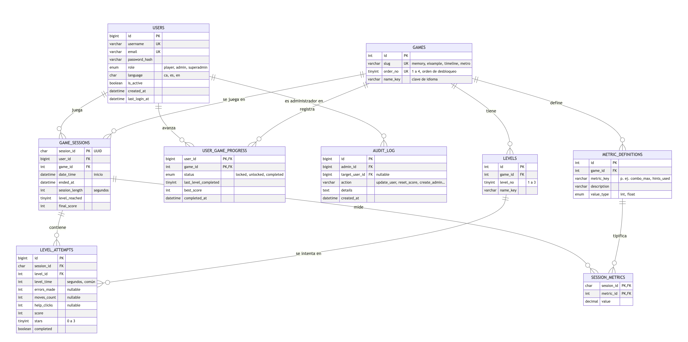
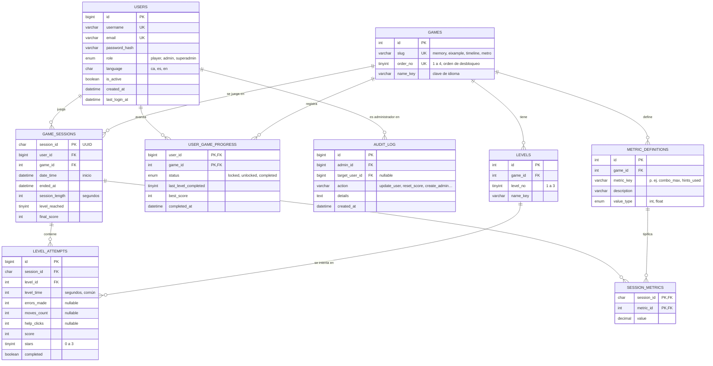

# Modelo relacional de la base de datos (borrador)

Borrador para validar con el equipo. Cubre los 4 juegos, el progreso por usuario, las métricas por sesión, los récords y la administración. Se pensó para MySQL/SQL Server (Laravel); los tipos son orientativos. Los diagramas usan Mermaid y se ven directamente en GitHub.

## Diagrama entidad-relación

_Versión editable (Mermaid):_

## Tablas
| Tabla | Para qué sirve | Claves |
|---|---|---|
| `users` | Jugadores, administradores y superadministradores en una sola tabla; el rol decide qué ve cada uno | PK `id`; únicos `username`, `email` |
| `games` | Los 4 juegos y su orden de desbloqueo | PK `id`; único `slug` y `order_no` |
| `levels` | Niveles internos de cada juego (3 por juego) | FK `game_id`; único (`game_id`, `level_no`) |
| `user_game_progress` | Qué juegos tiene bloqueados, abiertos o superados cada usuario, y por qué nivel va (retomar donde lo dejó) | PK compuesta (`user_id`, `game_id`) |
| `game_sessions` | Una fila por partida: las 4 métricas obligatorias (`username` sale de `users`, más `session_id`, `date_time`, `session_length`) | PK `session_id` |
| `level_attempts` | **Métricas comunes** de cada nivel dentro de una sesión: tiempo, errores, movimientos, ayudas, puntos y estrellas. Las que un juego no usa quedan a `NULL` | FK `session_id`, `level_id` |
| `metric_definitions` | Catálogo de las **métricas individuales** que solo tiene un juego | FK `game_id`; único (`game_id`, `metric_key`) |
| `session_metrics` | Valor de cada métrica individual en cada sesión | PK compuesta (`session_id`, `metric_id`) |
| `audit_log` | Quién (administrador) cambió qué usuario o puntuación y cuándo | FK `admin_id`, `target_user_id` |

## Métricas: comunes en la BD común, individuales aparte
Salen de las fichas de cada juego en `propostes/`. Las que se repiten entre juegos van en columnas de tablas comunes; las que solo tiene un juego van en `session_metrics`.

| Métrica | Memory | Eixample | Línea del tiempo | Metro | Dónde va |
|---|:-:|:-:|:-:|:-:|---|
| `level_time` | ✔ | ✔ | ✔ | ✔ | `level_attempts` (común) |
| `level_reached` | ✔ | | | ✔ | `game_sessions` (común; se puede calcular en todos los juegos) |
| `final_score` | | | ✔ | ✔ | `game_sessions` (común; Memory y Eixample también puntúan) |
| `errors_made` | ✔ | | ✔ | | `level_attempts` (común, `NULL` si no aplica) |
| `moves_count` | | ✔ | | ✔ | `level_attempts` (común, `NULL` si no aplica) |
| `help_clicks` | | ✔ | ✔ (`hints_used`) | ✔ | `level_attempts` (común) |
| `attempts` | ✔ | | | | `session_metrics` (individual) |
| `puzzles_solved` | | ✔ | | | `session_metrics` (individual) |

Dos ajustes a hablar con el equipo:
- **`hints_used` (Raúl) = `help_clicks`** (Roger y Alex): es la misma idea, consultar una ayuda. Propongo usar `help_clicks` en los cuatro para poder compararlos.
- Cada juego sigue necesitando **al menos 4 métricas propias** además de las 4 de sesión. Con esta estructura se cumple: Memory (`attempts`, `errors_made`, `level_reached`, `level_time`), Eixample (`moves_count`, `help_clicks`, `puzzles_solved`, `level_time`), Línea del tiempo (`errors_made`, `level_time`, `help_clicks`, `final_score`) y Metro (`level_reached`, `level_time`, `moves_count`, `help_clicks`, `final_score`). Si un juego necesita otra (por ejemplo `combo_max` en Memory), se da de alta en `metric_definitions` sin tocar las tablas.

## Decisiones de diseño
1. **Una sola base de datos para los 4 juegos** y las métricas repetidas en columnas de `level_attempts` y `game_sessions`: son las que más se consultan y las que usará la vista «Mètriques» y la simulación en Python. Los `NULL` indican «este juego no mide esto».
2. **Las métricas individuales en filas (`session_metrics`)**, para no llenar las tablas de columnas que solo usa un juego.
3. **Récords diarios y semanales** no se guardan: se calculan con consultas sobre `game_sessions` (`MAX(final_score)` por día, semana y juego). Se puede crear una vista.
4. **Desbloqueo en orden**: se abre el juego `n+1` cuando `user_game_progress` del juego `n` está en `completed`. Al crear un usuario se inserta el juego 1 como `unlocked` y los demás como `locked`.
5. **Plano de la landing**: las 4 piezas se pintan a partir de `user_game_progress` (una pieza por juego `completed`); no hace falta tabla de piezas.
6. **Roles**: administrador y superadministrador están en `users.role`. Las comprobaciones de permisos se hacen siempre en el servidor. El superadministrador es el único que puede crear o cambiar usuarios con rol `admin`.
7. **Auditoría** simple en `audit_log` para poder defender quién modificó puntuaciones.
8. **Idioma**: `users.language` guarda el idioma elegido; los textos de la interfaz viven en archivos de idioma, no en la BD (`name_key` apunta a esa clave).

## Por decidir con el equipo
- ¿Motor definitivo (MySQL o SQL Server)? Cambia solo los tipos.
- ¿Registro público de jugadores o solo por invitación? (afecta a `users`).
- ¿Se guarda el progreso también sin registrarse (invitado) o solo con usuario?
