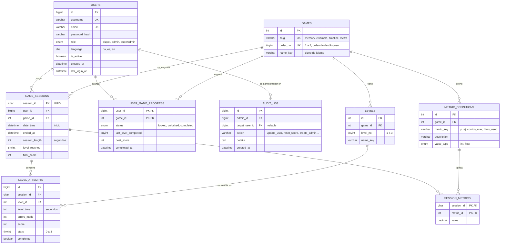

# Modelo relacional de la base de datos (borrador)

Borrador para validar con el equipo. Cubre los 4 juegos, el progreso por usuario, las métricas por sesión, los récords y la administración. Se pensó para MySQL/SQL Server (Laravel); los tipos son orientativos. Los diagramas usan Mermaid y se ven directamente en GitHub.

## Diagrama entidad-relación

## Tablas
| Tabla | Para qué sirve | Claves |
|---|---|---|
| `users` | Jugadores, administradores y superadministradores en una sola tabla; el rol decide qué ve cada uno | PK `id`; únicos `username`, `email` |
| `games` | Los 4 juegos y su orden de desbloqueo | PK `id`; único `slug` y `order_no` |
| `levels` | Niveles internos de cada juego (3 por juego) | FK `game_id`; único (`game_id`, `level_no`) |
| `user_game_progress` | Qué juegos tiene bloqueados, abiertos o superados cada usuario, y por qué nivel va (retomar donde lo dejó) | PK compuesta (`user_id`, `game_id`) |
| `game_sessions` | Una fila por partida: las 4 métricas obligatorias (`username` sale de `users`, más `session_id`, `date_time`, `session_length`) | PK `session_id` |
| `level_attempts` | Resultado de cada nivel dentro de una sesión: tiempo, errores, puntos, estrellas | FK `session_id`, `level_id` |
| `metric_definitions` | Catálogo de métricas propias de cada juego (mínimo 4 por juego) | FK `game_id`; único (`game_id`, `metric_key`) |
| `session_metrics` | Valor de cada métrica propia en cada sesión | PK compuesta (`session_id`, `metric_id`) |
| `audit_log` | Quién (administrador) cambió qué usuario o puntuación y cuándo | FK `admin_id`, `target_user_id` |

## Decisiones de diseño
1. **Métricas propias en filas (`session_metrics`)** y no en columnas. Cada juego tiene métricas distintas (`combo_max`, `hints_used`, `help_clicks`, `moves_count`…) y así no hay una tabla con 20 columnas casi vacías. Para la vista «Mètriques» se puede pasar a formato ancho con un `PIVOT` o con Pandas.
2. **Métricas comunes** (`level_time`, `level_reached`, `final_score`) como columnas, porque los cuatro juegos las tienen y se consultan siempre.
3. **Récords diarios y semanales** no se guardan: se calculan con consultas sobre `game_sessions` (`MAX(final_score)` por día, semana y juego). Se puede crear una vista.
4. **Desbloqueo en orden**: se abre el juego `n+1` cuando `user_game_progress` del juego `n` está en `completed`. Al crear un usuario se inserta el juego 1 como `unlocked` y los demás como `locked`.
5. **Plano de la landing**: las 4 piezas se pintan a partir de `user_game_progress` (una pieza por juego `completed`); no hace falta tabla de piezas.
6. **Roles**: administrador y superadministrador están en `users.role`. Las comprobaciones de permisos se hacen siempre en el servidor. El superadministrador es el único que puede crear o cambiar usuarios con rol `admin`.
7. **Auditoría** simple en `audit_log` para poder defender quién modificó puntuaciones.
8. **Idioma**: `users.language` guarda el idioma elegido; los textos de la interfaz viven en archivos de idioma, no en la BD (`name_key` apunta a esa clave).

## Ejemplo de métricas propias por juego (según las fichas)
| Juego | `metric_key` |
|---|---|
| 1 · Memory | `attempts`, `errors_made`, `level_reached`, `level_time` |
| 2 · Eixample | `moves_count`, `help_clicks`, `puzzles_solved`, `level_time` |
| 3 · Línea del tiempo | `errors_made`, `level_time`, `hints_used`, `final_score` |
| 4 · Metro | `level_reached`, `level_time`, `moves_count`, `help_clicks`, `final_score` |

`[PENDENT]` Decidir qué métricas son comunes (columnas) y cuáles propias (filas): `level_time`, `level_reached` y `final_score` aparecen en casi todos.

## Por decidir con el equipo
- ¿Motor definitivo (MySQL o SQL Server)? Cambia solo los tipos.
- ¿Registro público de jugadores o solo por invitación? (afecta a `users`).
- ¿Se guarda el progreso también sin registrarse (invitado) o solo con usuario?
