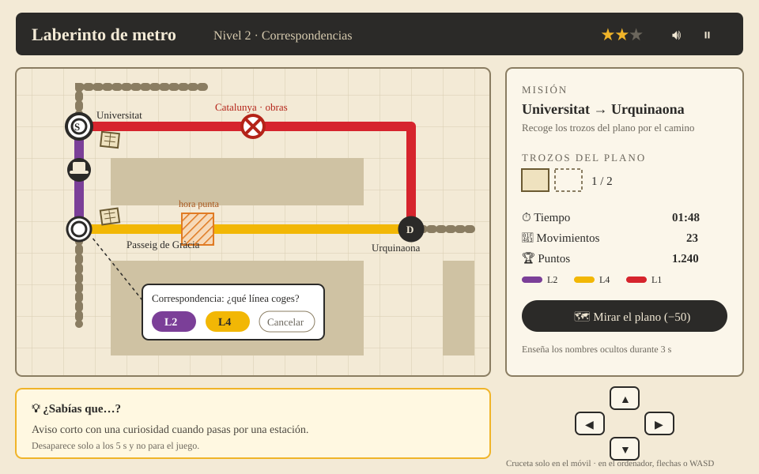

# Laberinto de metro
**Nivel 4 de «Ildefons Cerdà perdió el plano»** · Responsable del juego: Alex Campano

## Qué se aprende
A moverse por el metro de Barcelona: qué color tiene cada línea, por qué estaciones pasa y dónde se puede cambiar de una línea a otra.

## De qué va
Es el último juego de la ruta por el centro de Barcelona. Tras el juego 3 tenemos la llave de la estación de **Universitat**: bajamos al metro, donde se han perdido los últimos trozos del plano de Cerdà. El metro es un laberinto: movemos una ficha por las vías, recogemos los trozos y llegamos a **Urquinaona**, donde está nuestro centro. Allí se junta el plano completo.

## Cómo se juega
- La ficha se mueve con las flechas del teclado, o con los botones de la pantalla en el móvil.
- Solo se puede ir por las vías. Si chocas contra una pared, no te mueves.
- Para cambiar de línea hay que estar en una estación con correspondencia. Ahí aparecen unos botones con las líneas y eliges una.
- Hay que recoger todos los trozos del plano antes de llegar al destino.
- Si te pierdes, el botón «Mirar el plano» enseña los nombres de las estaciones durante 3 segundos, pero resta puntos.

## Niveles
El eje es la **L1** (Universitat → Catalunya → Urquinaona → Arc de Triomf). Los tres niveles empiezan en Universitat y acaban en Urquinaona.

| Nivel | Viaje | Qué lo hace más difícil |
|---|---|---|
| 1 | Universitat → Urquinaona | Solo la L1, con todos los nombres a la vista y 1 trozo del plano en Catalunya. Sirve para aprender a moverse. |
| 2 | Universitat → Urquinaona | Catalunya está cerrada por obras: hay que ir por la L2 hasta Passeig de Gràcia y cambiar a la L4. Hay 2 trozos y una casilla de «hora punta» que se abre y se cierra. |
| 3 | Universitat → Urquinaona | Hay que pasar por Passeig de Gràcia y por Arc de Triomf antes de llegar. Nombres ocultos (salvo salida, destino y trozos) y tiempo límite. |

Al acabar el nivel 3 se juntan las cuatro piezas del plano en Urquinaona, aparece el plano completo y la nota final de Cerdà. Se puede mencionar Glòries como la plaza que Cerdà pensó como centro de la ciudad.

## Cómo encaja con los otros juegos
Según la [propuesta de unión](propuesta-union-de-los-juegos.md):
- **Entra** desde el juego 3 (Línea del tiempo), que entrega la llave de la estación de Universitat. Si el jugador no ha superado el juego 3, este juego sale bloqueado.
- **Sale** con la pieza 4 del plano (el centro), que cierra el plano de la landing, y con la nota final de Cerdà.
- Usa el mismo estilo (papel sepia y tinta, variables CSS comunes) y los mismos nombres de métricas: `level_time`, `level_reached`, `final_score` y `help_clicks`.
- Guarda el progreso con el mismo formato que los demás juegos, para que la landing lo lea.

## Puntos y estrellas
- Empiezas con 1000 puntos. Cada movimiento resta 5, cada ayuda resta 50 y cada trozo recogido suma 100.
- Cada nivel tiene apuntado el número de movimientos de la ruta buena. Si lo haces con esos movimientos o muy pocos más, te llevas 3 estrellas; si te pasas un poco, 2; si te pasas mucho, 1.

## Cómo se programa
La idea es que sea fácil de programar y de explicar:
- **El mapa** de cada nivel es un array de textos, y cada letra es una casilla (pared, vía, estación, trozo…).
- **El tablero** se pinta con `div` dentro de un CSS Grid. No se usa `<canvas>`.
- **Mover la ficha:** un evento `keydown` comprueba si la casilla de destino es vía y, si lo es, mueve la ficha.
- **El reloj y la hora punta** funcionan con `setInterval`.
- **El progreso** (el último nivel superado) se guarda en `localStorage` y en la base de datos, así que al volver se sigue donde lo dejaste.

## Esbozo de la interfaz

## Métricas
Las comunes, `username`, `session_id`, `date_time` y `session_length`, más estas cinco propias:

| Métrica | Qué guarda |
|---|---|
| `level_reached` | Hasta qué nivel ha llegado |
| `level_time` | Segundos que ha tardado en el nivel |
| `moves_count` | Movimientos que ha hecho |
| `help_clicks` | Veces que ha mirado el plano |
| `final_score` | Puntos al acabar |

En la simulación de datos supondremos que quien pide muchas ayudas o hace muchos movimientos de más tiene más probabilidades de no volver a jugar.

## Pendiente
- Comprobar las estaciones con el plano oficial de TMB.
- Dibujar los mapas de los niveles 2 y 3 sobre la L1, la L2 y la L4.
- Comprobar el orden de la L2 (Universitat → Passeig de Gràcia) y de la L4 (Passeig de Gràcia → Urquinaona).
- Para la primera entrega (17/11), tener el nivel 1 jugable.
